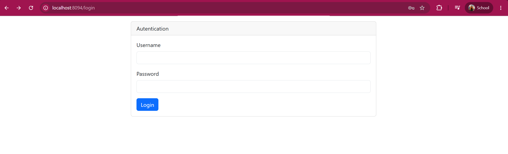
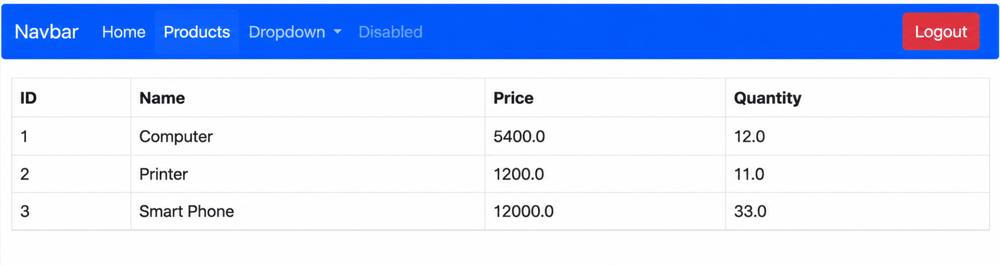

# 🛒 Gestion des produits — Spring Boot, JPA, Thymeleaf & Spring Security

Application Web JEE de gestion de produits (CRUD) construite avec **Spring Boot**, **Spring Data JPA / Hibernate**, **Thymeleaf** (layout + Bootstrap) et **Spring Security** (authentification et autorisation par rôles).

> Vidéo de référence : https://www.youtube.com/watch?v=FHy7raIldgg

---

## 📑 Sommaire

1. [Objectifs](#-objectifs)
2. [Technologies utilisées](#-technologies-utilisées)
3. [Architecture du projet](#-architecture-du-projet)
4. [Étapes de réalisation](#-étapes-de-réalisation)
5. [Gestion des rôles (ADMIN / USER)](#-gestion-des-rôles-admin--user)
6. [Captures d'écran](#-captures-décran)
7. [Installation et exécution](#-installation-et-exécution)
8. [Fonctionnalités supplémentaires](#-fonctionnalités-supplémentaires)
9. [Conclusion](#-conclusion)

---

## 🎯 Objectifs

Créer une application Web permettant de gérer des produits :

- Afficher la liste des produits
- Ajouter un produit (avec validation du formulaire)
- Supprimer un produit
- Rechercher des produits
- Modifier / mettre à jour un produit
- Sécuriser l'application (authentification + rôles)
- Utiliser une page template commune (Thymeleaf Layout + Bootstrap)

---

## 🧰 Technologies utilisées

| Technologie | Rôle |
|---|---|
| Java 17+ | Langage |
| Spring Boot | Socle de l'application |
| Spring Web (MVC) | Contrôleurs et routage |
| Spring Data JPA / Hibernate | Accès aux données (ORM) |
| H2 / MySQL | Base de données (dev / production) |
| Thymeleaf + Layout Dialect | Moteur de vues et template |
| Bootstrap 5 | Interface responsive |
| Spring Security | Authentification et autorisation |
| Spring Validation | Validation des formulaires |
| Lombok | Réduction du code répétitif |
| Maven | Gestion des dépendances |

---

## 🗂️ Architecture du projet

```
src/main
├── java/com/example/gestionproduits
│   ├── GestionProduitsApplication.java
│   ├── entities
│   │   └── Product.java
│   ├── repository
│   │   └── ProductRepository.java
│   ├── security
│   │   └── SecurityConfig.java
│   └── web
│       └── ProductController.java
└── resources
    ├── application.properties
    └── templates
        ├── template1.html        # Layout commun (navbar + Bootstrap)
        ├── products.html         # Liste + recherche
        ├── new-product.html      # Formulaire d'ajout
        ├── edit-product.html     # Formulaire de modification
        ├── login.html            # Page d'authentification
        └── notAuthorized.html    # Page 403
```

> Adaptez le nom du package à celui de votre projet.

---

## 🪜 Étapes de réalisation

### 1. Création du projet Spring Boot

Dépendances (via Spring Initializr) : **Spring Web, Spring Data JPA, H2 Database, MySQL Driver, Thymeleaf, Lombok, Spring Security, Validation**.

Dépendance supplémentaire pour le layout Thymeleaf :

```xml
<dependency>
    <groupId>nz.net.ultraq.thymeleaf</groupId>
    <artifactId>thymeleaf-layout-dialect</artifactId>
</dependency>
<dependency>
    <groupId>org.thymeleaf.extras</groupId>
    <artifactId>thymeleaf-extras-springsecurity6</artifactId>
</dependency>
```

### 2. Entité JPA `Product`

```java
@Entity
@Data @NoArgsConstructor @AllArgsConstructor @Builder
public class Product {
    @Id @GeneratedValue(strategy = GenerationType.IDENTITY)
    private Long id;

    @NotEmpty
    @Size(min = 3, max = 50)
    private String name;

    @Min(0)
    private double price;

    @Min(0)
    private double quantity;
}
```

### 3. Interface `ProductRepository` (Spring Data)

```java
public interface ProductRepository extends JpaRepository<Product, Long> {
    List<Product> findByNameContainsIgnoreCase(String keyword);
}
```

### 4. Test de la couche DAO

```java
@SpringBootApplication
public class GestionProduitsApplication {

    public static void main(String[] args) {
        SpringApplication.run(GestionProduitsApplication.class, args);
    }

    @Bean
    CommandLineRunner start(ProductRepository repo) {
        return args -> {
            repo.save(Product.builder().name("computer").price(5400).quantity(12).build());
            repo.save(Product.builder().name("printer").price(1200).quantity(11).build());
            repo.save(Product.builder().name("smart phone").price(8400).quantity(33).build());
            repo.findAll().forEach(p -> System.out.println(p.getName()));
        };
    }
}
```

### 5. Désactivation de la protection par défaut de Spring Security

Dans un premier temps (phase de développement), toutes les requêtes sont autorisées :

```java
@Configuration
@EnableWebSecurity
public class SecurityConfig {
    @Bean
    SecurityFilterChain filterChain(HttpSecurity http) throws Exception {
        return http.authorizeHttpRequests(a -> a.anyRequest().permitAll())
                   .csrf(csrf -> csrf.disable())
                   .build();
    }
}
```

### 6. Contrôleur Spring MVC et vues Thymeleaf

```java
@Controller
@AllArgsConstructor
public class ProductController {

    private final ProductRepository productRepository;

    @GetMapping("/user/index")
    public String index(Model model,
                        @RequestParam(defaultValue = "") String keyword) {
        model.addAttribute("products",
                productRepository.findByNameContainsIgnoreCase(keyword));
        model.addAttribute("keyword", keyword);
        return "products";
    }

    @PostMapping("/admin/delete")
    public String delete(@RequestParam Long id) {
        productRepository.deleteById(id);
        return "redirect:/user/index";
    }

    @GetMapping("/admin/newProduct")
    public String newProduct(Model model) {
        model.addAttribute("product", new Product());
        return "new-product";
    }

    @PostMapping("/admin/save")
    public String save(@Valid Product product, BindingResult result) {
        if (result.hasErrors()) return "new-product";
        productRepository.save(product);
        return "redirect:/user/index";
    }

    @GetMapping("/admin/editProduct")
    public String edit(@RequestParam Long id, Model model) {
        model.addAttribute("product", productRepository.findById(id).orElseThrow());
        return "edit-product";
    }

    @GetMapping("/")
    public String home() {
        return "redirect:/user/index";
    }
}
```

**Template commun (`template1.html`)** : barre de navigation Bootstrap (titre « Gestion des produits », liens *Home* / *Products*, bouton *Logout*) et zone `layout:fragment="content"` pour le contenu de chaque page.

**Formulaire avec validation** (`new-product.html`) :

```html
<form method="post" th:action="@{/admin/save}" th:object="${product}">
    <label class="form-label">Nom du produit</label>
    <input class="form-control" type="text" th:field="*{name}" placeholder="Entrez le nom">
    <span class="text-danger" th:errors="*{name}"></span>

    <label class="form-label">Prix</label>
    <input class="form-control" type="number" step="any" th:field="*{price}">
    <span class="text-danger" th:errors="*{price}"></span>

    <label class="form-label">Quantité</label>
    <input class="form-control" type="number" step="any" th:field="*{quantity}">
    <span class="text-danger" th:errors="*{quantity}"></span>

    <button type="submit" class="btn btn-success">Enregistrer</button>
    <a th:href="@{/user/index}" class="btn btn-secondary">Retour</a>
</form>
```

### 7. Sécurisation avec Spring Security

```java
@Configuration
@EnableWebSecurity
@EnableMethodSecurity
public class SecurityConfig {

    @Bean
    PasswordEncoder passwordEncoder() {
        return new BCryptPasswordEncoder();
    }

    @Bean
    InMemoryUserDetailsManager userDetailsManager(PasswordEncoder pe) {
        return new InMemoryUserDetailsManager(
            User.withUsername("user").password(pe.encode("1234")).roles("USER").build(),
            User.withUsername("admin").password(pe.encode("1234")).roles("USER", "ADMIN").build()
        );
    }

    @Bean
    SecurityFilterChain filterChain(HttpSecurity http) throws Exception {
        return http
            .formLogin(f -> f.loginPage("/login").defaultSuccessUrl("/user/index", true).permitAll())
            .authorizeHttpRequests(a -> a
                .requestMatchers("/login", "/webjars/**").permitAll()
                .requestMatchers("/admin/**").hasRole("ADMIN")
                .requestMatchers("/user/**").hasAnyRole("USER", "ADMIN")
                .anyRequest().authenticated())
            .exceptionHandling(e -> e.accessDeniedPage("/notAuthorized"))
            .build();
    }
}
```

Dans la vue, les boutons sensibles ne sont affichés qu'à l'administrateur :

```html
<a sec:authorize="hasRole('ADMIN')" th:href="@{/admin/newProduct}" class="btn btn-primary">New Product</a>

<td sec:authorize="hasRole('ADMIN')">
    <a class="btn btn-danger btn-sm"
       onclick="return confirm('Etes-vous sûr ?')"
       th:href="@{/admin/delete(id=${p.id}, keyword=${keyword})}">Delete</a>
</td>
```

### 8. Fonctionnalités supplémentaires

- 🔎 **Recherche** de produits par nom (`findByNameContainsIgnoreCase`)
- ✏️ **Édition / mise à jour** d'un produit existant
- 🔐 **Page 403** personnalisée (`/notAuthorized`)
- ⚠️ **Confirmation** avant suppression
- 🔄 Possibilité d'ajouter une **pagination** (`Pageable`) et une **base MySQL** pour la production

---

## 👥 Gestion des rôles (ADMIN / USER)

| Fonctionnalité | USER | ADMIN |
|---|:---:|:---:|
| Se connecter / se déconnecter | ✅ | ✅ |
| Consulter la liste des produits | ✅ | ✅ |
| Rechercher un produit | ✅ | ✅ |
| Ajouter un produit (*New Product*) | ❌ | ✅ |
| Supprimer un produit (*Delete*) | ❌ | ✅ |
| Modifier un produit | ❌ | ✅ |

Comptes de démonstration (à adapter selon votre configuration) :

| Utilisateur | Mot de passe | Rôles |
|---|---|---|
| `user` | `1234` | USER |
| `admin` | `1234` | USER, ADMIN |

---

## 📸 Captures d'écran

### 1. Page d'authentification (Login)

Accessible sur `http://localhost:8094/login`. L'utilisateur saisit son nom d'utilisateur et son mot de passe.



---

### 2. Liste des produits — vue **ADMIN**

L'administrateur voit le bouton **New Product** ainsi que la colonne **Action** avec le bouton **Delete** pour chaque produit.


---

### 3. Page d'ajout d'un produit (réservée à l'ADMIN)

Formulaire « Ajouter un nouveau produit » avec les champs *Nom du produit*, *Prix* et *Quantité*, validés côté serveur. Boutons **Enregistrer** et **Retour**.


---

### 4. Liste des produits — vue **USER**

L'utilisateur simple a un accès en **lecture seule** : il consulte la liste des produits et dispose du bouton **Logout**, sans les actions *New Product* ni *Delete*.



---

## ▶️ Installation et exécution

### Prérequis

- JDK 17 ou supérieur
- Maven 3.8+
- (Optionnel) MySQL 8

### Configuration (`application.properties`)

```properties
server.port=8094

# --- H2 (développement) ---
spring.datasource.url=jdbc:h2:mem:products-db
spring.h2.console.enabled=true
spring.jpa.hibernate.ddl-auto=create

# --- MySQL (production) : décommenter ---
# spring.datasource.url=jdbc:mysql://localhost:3306/products-db?createDatabaseIfNotExist=true
# spring.datasource.username=root
# spring.datasource.password=
# spring.jpa.hibernate.ddl-auto=update
# spring.jpa.show-sql=true
```

### Lancer l'application

```bash
git clone <url-de-votre-depot>
cd gestion-produits
mvn spring-boot:run
```

Puis ouvrir : **http://localhost:8094** (redirection automatique vers `/login`).

Console H2 (si activée) : http://localhost:8094/h2-console

---

## ✅ Conclusion

Ce projet met en pratique les concepts essentiels d'une application JEE moderne :

- **Persistance** avec Spring Data JPA et Hibernate
- **Architecture MVC** avec Spring MVC et Thymeleaf
- **Interface** responsive avec Bootstrap et un template commun
- **Validation** des données côté serveur
- **Sécurité** avec authentification et autorisation basées sur les rôles (ADMIN / USER)

---

👤 **Auteur** : *MATMOUR YASSMINE*

